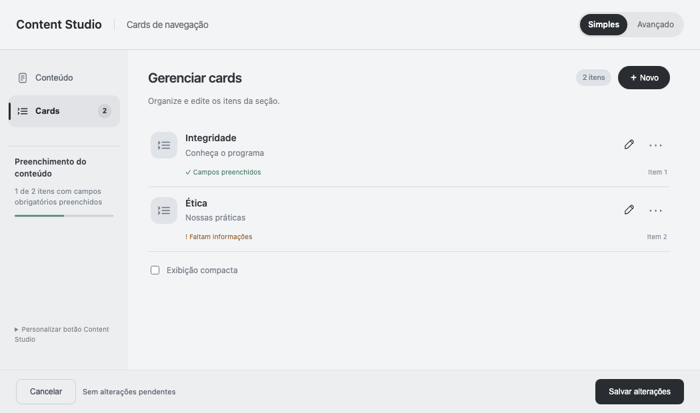
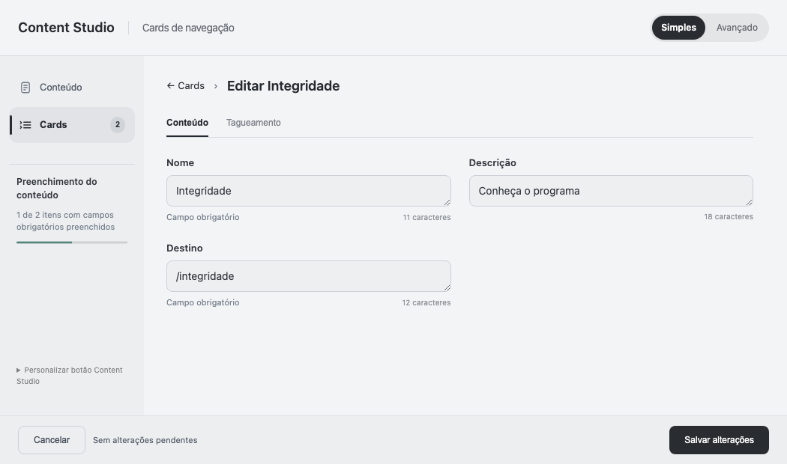
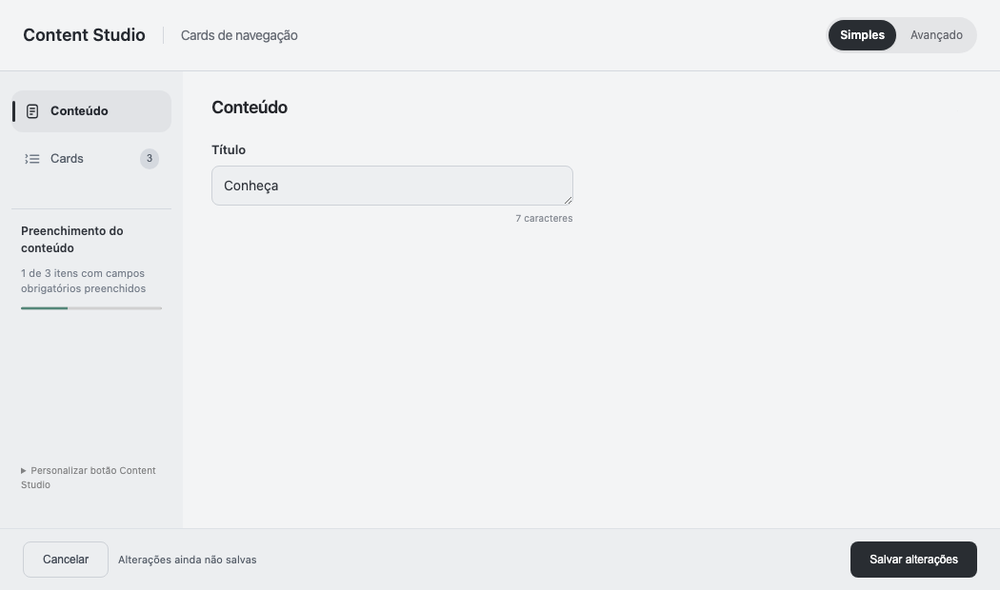
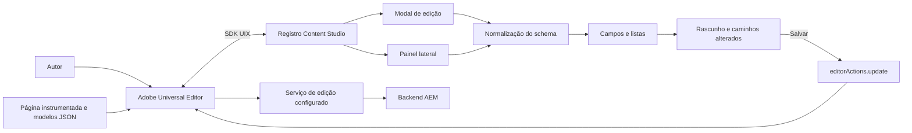
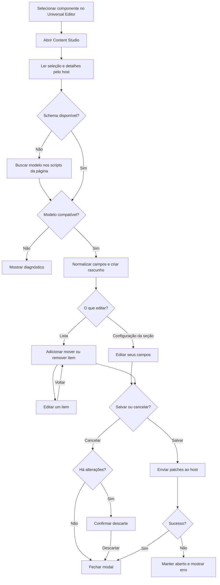
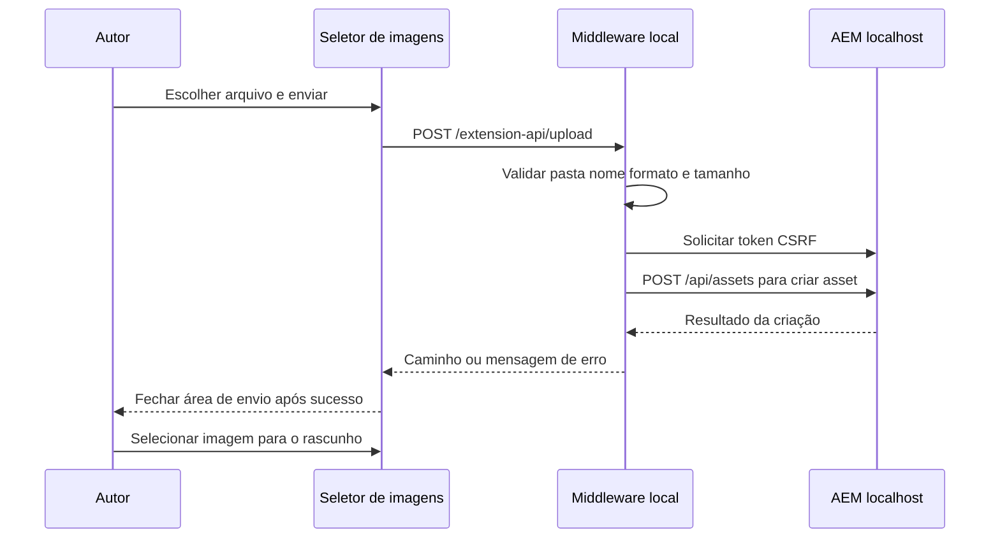

# Content Studio — Universal Editor

Extensão independente para o **Adobe AEM Universal Editor** que organiza a edição de componentes em um modal ou painel próprio. A interface é construída a partir dos modelos da página, com navegação entre configurações da seção, listas e itens individuais.

Adiciona a ação **Content Studio** à barra do editor e uma entrada na lateral. O painel nativo da Adobe continua disponível. Esta extensão usa controles próprios; ela não incorpora o formulário nativo da Adobe.

## Visualização

As imagens abaixo são capturas da interface atual renderizada em Chromium com dados fictícios e um host simulado. Mostram o conteúdo da extensão; a moldura externa do modal e a barra do Universal Editor são fornecidas pela Adobe e não aparecem nestas capturas. Não são evidência de uma sessão autenticada nem de gravação no AEM.

### Gerenciar uma lista



A lista apresenta o resumo de cada item. O lápis abre sua edição; o menu de opções permite mover e remover. A ação **Novo** adiciona um item ao rascunho. A exibição compacta reduz a altura das linhas.

### Editar um item



O item é editado separadamente, com retorno à lista sem perder o rascunho. Quando o modelo define campos de tagueamento, eles podem aparecer na seção correspondente. As opções e os campos dependem do modelo recebido.

### Editar os campos da seção



Os campos gerais permanecem separados da lista. Textos e selects podem ser editados diretamente; imagens apresentam miniatura e ações de substituir/remover. Rich text usa Tiptap, com sanitização de HTML.

## Recursos e limites

| Recurso | Comportamento |
| --- | --- |
| Texto e textarea | Edição, ajuda e contador de caracteres |
| Número e boolean | Controles conforme o tipo do modelo |
| Select e radio group | Opções recebidas do modelo; select disponível diretamente |
| Rich text | Editor próprio com Tiptap; não é o RTE nativo da Adobe |
| Imagens | Miniatura, biblioteca, substituição e remoção |
| Links | Edição do destino; não é um picker nativo de páginas AEM |
| Containers e listas | Inclusão, edição individual, reordenação e remoção no rascunho |
| Abas e condições | Normalização e interpretação pelo renderer; validar as regras do seu projeto |
| Simples/Avançado | Alterna a disponibilidade da seção Avançado |
| Preenchimento | Considera os campos obrigatórios definidos no modelo; não mede qualidade editorial |
| Gravação | Ações do host Adobe; fechamento do modal após sucesso |

O renderer não substitui toda a biblioteca de campos Adobe. Tipos ou estruturas não suportados podem exigir adaptadores. Validações no navegador não substituem permissões e validações do backend. Não presumir compatibilidade universal sem um teste de gravação e reabertura com os modelos do projeto.

## Arquitetura

A extensão é um projeto TypeScript/Vite separado da aplicação editada. O SDK `@adobe/uix-guest` conecta seus iframes ao Universal Editor.



### Responsabilidades

| Camada | Arquivo | Responsabilidade |
| --- | --- | --- |
| Integração UIX | `web-src/src/main.ts` | `register`, `attach`, ação da barra, painel e contexto selecionado |
| Modelos e formulários | `web-src/src/main.ts` | Normalizar schemas, montar abas, campos, listas e rascunhos |
| Rich text | `web-src/src/rich-text.ts` | Tiptap, ferramentas e sanitização com DOMPurify |
| Biblioteca | `web-src/src/asset-picker.ts` | Pastas, busca local, paginação e seleção de assets |
| Envio de imagem | `web-src/src/asset-upload.ts` | Arquivo, progresso e resultado do upload local |
| Servidor de desenvolvimento | `server/upload.ts` | Envio ao DAM local com credenciais do servidor |
| Apresentação | `web-src/src/styles.css` | Layout, campos e estados visuais |
| App Builder | `app.config.yaml` e `src/universal-editor-ui-1/ext.config.yaml` | Extension point e entrada web |

### Rotas internas da extensão

São rotas por hash no mesmo `index.html`, não rotas adicionadas ao site editado:

| Rota | Função |
| --- | --- |
| `/` | Registra a extensão no host |
| `/#/modal/editor` | Conteúdo do modal |
| `/#/rail/editor` | Conteúdo do painel lateral |
| `/#/renderer/cards` | Renderer de campo opcional; exige associação no modelo do projeto |

O renderer opcional é registrado com o tipo `content-studio-card-list`. O modal e o painel não dependem de ativar esse tipo personalizado nos modelos.

## Fluxo de edição



`editorActions.details` fornece os dados e o schema. Se o schema não estiver disponível, a extensão tenta ler `application/vnd.adobe.aue.model+json` na página. Esses fetches usam `credentials: omit`: a página/modelos precisam estar acessíveis e permitir CORS para a origem da extensão quando necessário.

O rascunho é mantido na memória da interface. Ao salvar, caminhos filhos já cobertos por um caminho pai são agrupados, e os patches `replace` são enviados sequencialmente. **Não há transação nem rollback automático:** se uma atualização falhar após outra ter sido aceita, pode haver gravação parcial. Reabra e confira o conteúdo antes de repetir operações importantes.

## Instalação e execução local

### Pré-requisitos

- Node.js 22 ou superior e npm.
- Git e `mkcert` para gerar certificados locais confiáveis.
- Conta com acesso à organização Adobe e ao Universal Editor.
- Página instrumentada com `data-aue-*`, modelos JSON e conexão de edição configurada.
- Backend e permissões que permitam editar os recursos selecionados.

### 1. Baixar e instalar dependências

```sh
git clone https://github.com/Davavincoaraujo/content-studio-universo-editor.git
cd content-studio-universo-editor
npm ci
```

### 2. Configurar HTTPS local

No macOS, se precisar instalar `mkcert`:

```sh
brew install mkcert
```

Gere os arquivos esperados pelo Vite:

```sh
mkdir -p .local-cert
mkcert -install
mkcert -key-file .local-cert/localhost-key.pem -cert-file .local-cert/localhost.pem localhost 127.0.0.1 ::1
```

`mkcert -install` registra a autoridade certificadora local no sistema. Credenciais e certificados locais não devem ser publicados.

### 3. Iniciar a extensão

```sh
npm run dev
```

Abra **https://localhost:9082/** para conferir o HTTPS. O registro precisa estar dentro do host Adobe para concluir: abrir a extensão isoladamente não fornece seleção nem schema. A porta é fixa; se estiver ocupada, o Vite interrompe a inicialização.

### 4. Abrir no Universal Editor

Abra sua página normalmente no Universal Editor e acrescente os parâmetros de preview `devMode=true` e `ext=https%3A%2F%2Flocalhost%3A9082`.

Exemplo para a rota do canvas no Experience Cloud; substitua `SUA_ORG`, o endereço do site e a página:

```text
https://experience.adobe.com/#/@SUA_ORG/aem/editor/canvas/localhost:3001/exemplo/index.html?devMode=true&ext=https%3A%2F%2Flocalhost%3A9082
```

Esse exemplo usa parâmetros na rota do canvas por hash. Preserve a URL funcional da sua sessão: hosts/roteamentos Adobe diferentes podem processar os parâmetros em outra posição. Se já houver query na rota, acrescente com `&`. Não duplique a organização nem acrescente `https:/` ao caminho do canvas. O endereço local e a extensão precisam estar disponíveis na máquina do navegador.

Selecione um componente e acione **Content Studio** na barra, ou abra seu painel lateral. Consulte também o [guia Adobe de preview local](https://developer.adobe.com/uix/docs/guides/preview-extension-locally/) e a [API do Universal Editor](https://developer.adobe.com/uix/docs/services/aem-universal-editor/); o guia geral usa exemplos de outros hosts e não substitui a URL própria do seu editor.

## Imagens e upload local

### Contrato da biblioteca de imagens

A implementação atual utiliza **um endpoint já existente na aplicação editada**, `/api/content?path=...`, como proxy para listar `/api/assets/...json` e carregar binários do DAM. Essa dependência é importante ao usar a extensão em outro site.

O repositório não instala nem cria esse proxy no site. Se sua aplicação não oferece o mesmo contrato, adapte `assetUrl` em `asset-picker.ts` para uma integração disponível, com autenticação e CORS adequados. Não considerar a seleção de imagens plug-and-play em qualquer projeto.

### Configuração opcional de envio

```sh
cp .env.example .env.local
```

Preencha apenas no arquivo local:

| Variável | Uso |
| --- | --- |
| `EXTENSION_AEM_URL` | AEM HTTP local, por exemplo `http://localhost:4502` |
| `EXTENSION_AEM_USER` | Conta local autorizada a enviar assets |
| `EXTENSION_AEM_PASSWORD` | Senha dessa conta; nunca no Git |
| `EXTENSION_UPLOAD_ROOT` | Raiz permitida do DAM, por exemplo `/content/dam` |

Reinicie o Vite após mudar a configuração. As variáveis `EXTENSION_*` são usadas pelo middleware do servidor; não são variáveis `VITE_*` incorporadas ao navegador.



O upload aceita PNG/JPEG/WebP/GIF/SVG até 10 MB, limita o destino à raiz configurada e usa POST para não sobrescrever assets existentes. Usa a conta configurada no servidor, não a identidade individual de cada autor. Enviar um asset é uma operação independente: cancelar o modal não apaga um arquivo já enviado.

Esse middleware atende somente AEM HTTP em `localhost`/`127.0.0.1`, vive no servidor de desenvolvimento e **não acompanha o bundle estático**. Não o exponha como serviço de produção; produção exige uma integração de servidor autenticada apropriada ao ambiente.

## Build e ativação na Adobe

### Gerar o bundle

```sh
npm run build
```

Gera `dist/`. Não exige certificados ou credenciais locais. A versão atual apresenta aviso de chunk maior que 500 kB no Vite; a compilação passa, mas o carregamento deve ser avaliado em conexões mais lentas.

### Publicar pelo App Builder

Este repositório não contém workspace, tokens ou configuração de uma organização Adobe. Para publicação:

1. Crie/configure um projeto Adobe Developer Console com App Builder e o extension point `universal-editor/ui/1` disponível.
2. Configure o Adobe I/O CLI e importe o workspace apropriado seguindo os guias Adobe.
3. Confirme a configuração `app.config.yaml`, `ext.config.yaml` e os requisitos da organização.
4. Execute `npm run deploy`, que roda build e `aio app deploy`.
5. Complete publicação/aprovação e ativação para a organização/ambiente conforme o mecanismo Adobe disponível.
6. Valide numa sessão de autor as permissões, modelos, leitura de imagens e gravação/reabertura.

Guias oficiais: [primeira aplicação App Builder](https://developer.adobe.com/app-builder/docs/get_started/app_builder_get_started/first-app), [publicação de UI Extensions](https://developer.adobe.com/uix/docs/guides/publication/) e [Extension Manager](https://developer.adobe.com/uix/docs/extension-manager/).

**Publicar código no GitHub não ativa a extensão na Adobe.** A extensão não é um ZIP de conteúdo AEM e não é instalada pelo Package Manager em `localhost:4502`.

## Diagnóstico rápido

| Sintoma | Verificação |
| --- | --- |
| Vite não inicia | Certificados nos caminhos esperados, dependências instaladas e porta 9082 livre |
| Não aparece Content Studio | URL de preview, acesso Adobe, HTTPS e requests da extensão no navegador |
| Nenhum componente selecionado | Selecione o componente na árvore/canvas antes de abrir o modal |
| Modelo indisponível | Confira `data-aue-model`, scripts JSON, formato do schema e CORS do fallback |
| Imagens não carregam | Confira o contrato `/api/content`, acesso ao DAM, raiz e filtros MIME |
| Upload indisponível | Vite ativo, `.env.local` configurado e AEM HTTP local acessível |
| Asset com nome existente | Renomeie o arquivo; o upload não substitui o asset |
| Salvar falha | Confira permissão, contrato do modelo e dados já gravados parcialmente |
| Campo não representado | Verifique o tipo recebido e implemente um adaptador; o painel nativo continua disponível |

## Validação e desenvolvimento

O build executa TypeScript e Vite. Os testes de interface realizados durante o desenvolvimento verificaram listas, edição individual, inclusão/ordenação, seleção direta, falha/sucesso de salvar e rolagem. As capturas deste README vêm de um cenário de host simulado. O harness de testes original pertence ao projeto de integração e não é distribuído neste repositório; não há script `npm test` configurado aqui.

Antes de ativar em outro projeto, execute um round-trip real: editar, salvar, recarregar, comparar conteúdo e ordem; teste cancelar e uma conta sem permissão. Adicionar/remover listas ou rich text requer compatibilidade de serialização com o backend.

## Estrutura do repositório

```text
.
├── README.md
├── app.config.yaml
├── src/universal-editor-ui-1/ext.config.yaml
├── web-src/
│   ├── index.html
│   └── src/
│       ├── main.ts
│       ├── styles.css
│       ├── rich-text.ts
│       ├── asset-picker.ts
│       └── asset-upload.ts
├── server/upload.ts
├── docs/images/
├── .env.example
├── package.json
├── package-lock.json
├── tsconfig.json
└── vite.config.ts
```

Credenciais, certificados, dependências instaladas e artefatos de build ficam fora do Git. O registro e o modal são independentes do código do site; as integrações específicas de leitura de modelos e assets precisam atender aos contratos descritos acima.
